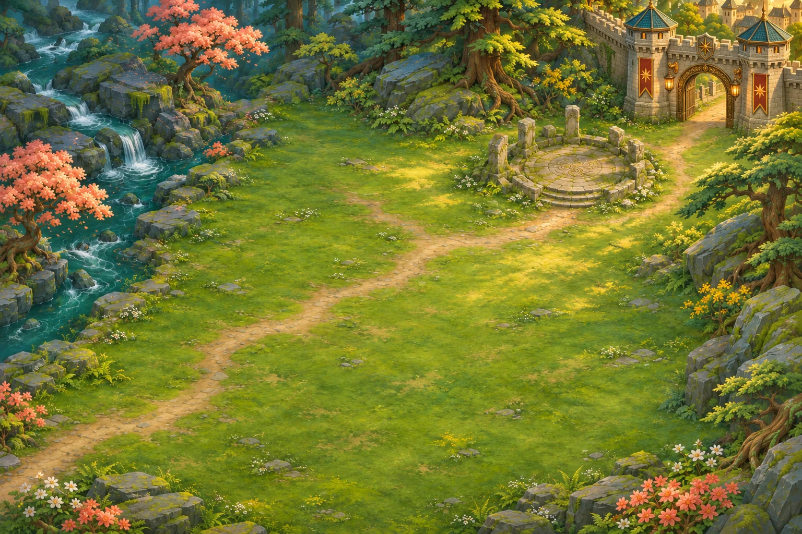

# Perfect 2.5D

O **Prado da Vigília** é o primeiro campo jogável das Terras Humanas. A trilha liga o portão da Cidadela da Bigorna ao riacho, à ponte e ao círculo de pedras. O cenário, as estruturas, os personagens e as criaturas são renderizados em 3D em tempo real.

## Abrir no navegador

No GitHub, use **Code → Download ZIP** e extraia os arquivos. Abra `Perfect-2.5D.html` no Chrome, Edge ou Firefox para jogar offline. Com WebGL 2, o jogo usa iluminação e sombras aceleradas. Também há renderização 3D por software. O navegador guarda o progresso solo no armazenamento local, quando disponível.

## Abrir no desktop

Instale Node.js 22.12 ou superior. Extraia o ZIP, abra um terminal na pasta do projeto e execute os comandos abaixo.

```sh
npm ci
npm run desktop
```

O primeiro arranque do Electron baixa o runtime para o seu sistema. Depois disso, o aplicativo abre offline e guarda o progresso solo no perfil do jogo. O código do aplicativo é compartilhado entre navegador e desktop.

## Jogar em duas janelas

Execute `npm start` na pasta do projeto e abra `http://127.0.0.1:4173` em duas abas ou janelas. Cada janela controla um personagem no mesmo campo. Posição, criaturas e chat são compartilhados, e os personagens recebem crédito pelos monstros que ajudaram a derrotar.

Para um teste na rede local, configure a variável `PERFECT_HOST` como `0.0.0.0` antes de iniciar o servidor e use o IP da máquina que hospeda. O progresso multiplayer dura enquanto o personagem estiver na sessão. A cidade, as contas e a persistência online ficam fora desta primeira área.

## Patrulha do portão

Fale com a Capitã Bruna, derrote um exemplar de cada espécie e volte ao portão para receber XP, moedas e uma poção. Completar a patrulha leva o personagem ao nível 2.

| Criatura | Habitat | Comportamento |
| --- | --- | --- |
| Brotinho de Musgo | Margens do riacho | Contra-ataca quando ferido |
| Raposa de Cinza | Prado aberto | Persegue quem se aproxima |
| Sentinela de Ferro | Círculo de pedras | Sinaliza um golpe pesado em área |

**Controles** — WASD, setas ou clique para mover. Clique numa criatura para se aproximar e atacar. Teclas 1–4 usam habilidades. E conversa, Tab alterna alvos e M abre o mapa. Arraste com o botão direito para girar a câmera e use a roda para aproximar.

## Código

`public/world.js` define o terreno e as regiões de navegação. `public/scenery.js` e `public/actors.js` constroem os modelos em 3D. `public/game.js` simula a área tanto no modo solo quanto no servidor. `desktop/main.cjs` abre os mesmos recursos em uma janela Electron.

O Three.js está incluído sob a licença MIT em `public/vendor/THREE-LICENSE.txt`.

## Arte conceitual

Estudo visual do prado e do portão. A área jogável usa modelos 3D construídos no código.


